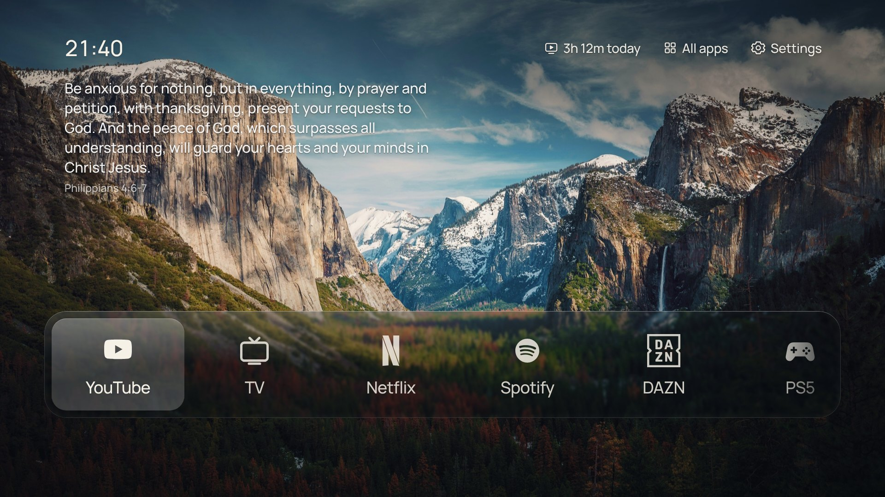
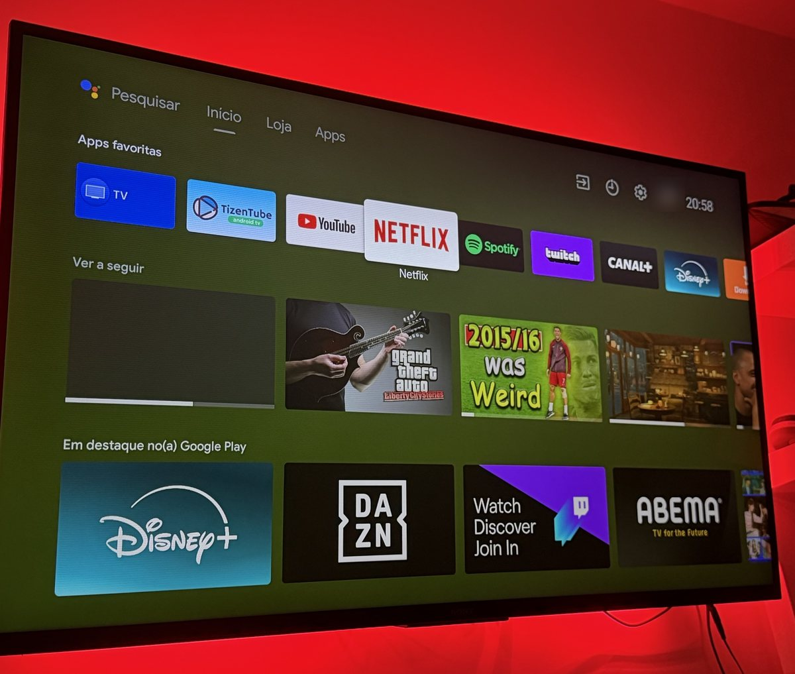
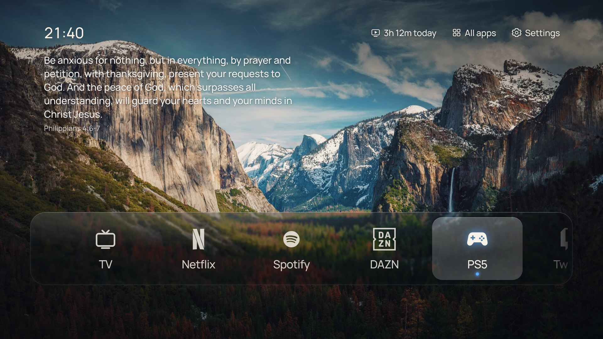
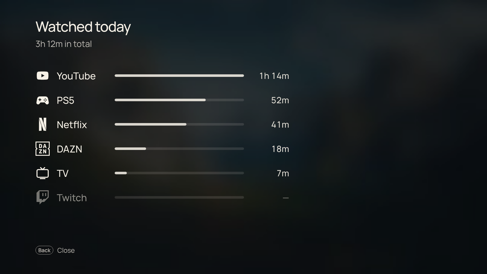
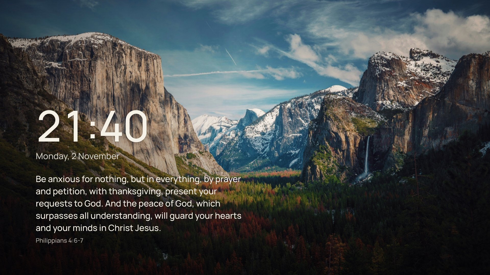
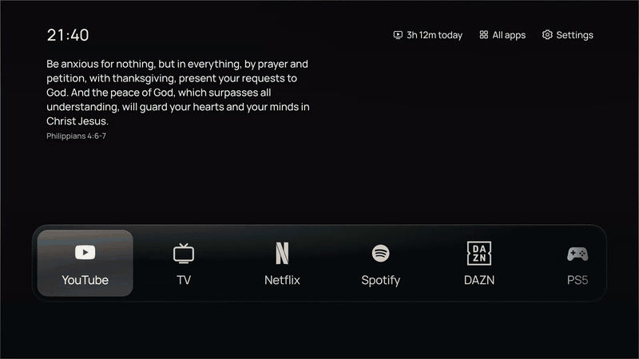
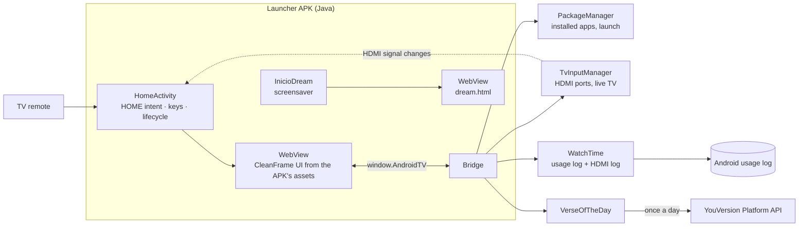

# A custom home screen for my Sony Bravia

[](https://github.com/davidr44/android-tv-web-launcher/actions/workflows/build.yml)

**An Android TV launcher that replaces my TV's factory home screen with only what I use: six apps, the PS5 one button away, a photo, the time, a Bible verse and how long I've watched today.**

> This has been the home screen of my Sony Bravia (Android TV 10) every day since October 2026. It's a personal project, built for one TV and installed from a PC, not from the Play Store. The interface is [CleanFrame](https://github.com/nthnclrk/CleanFrame), an open-source home screen for Samsung's The Frame, which I ported to Android and extended. This page explains what I built on top of it and why.

**Stack:** Java (Android 10 APIs, no AndroidX) · WebView · vanilla HTML/CSS/JS · Python build tooling (no Android SDK) · adb · YouVersion Platform API · Playwright · GitHub Actions



---

## Contents

- [The problem](#the-problem)
- [What it does](#what-it-does)
- [Architecture](#architecture)
- [Key decisions](#key-decisions)
- [Things I tried and dropped](#things-i-tried-and-dropped)
- [Incident: the app that never counted](#incident-the-app-that-never-counted)
- [Performance on the TV](#performance-on-the-tv)
- [How I built it](#how-i-built-it)
- [Repo contents](#repo-contents)
- [Credits](#credits)
- [Limitations and next steps](#limitations-and-next-steps)
- [What this project shows](#what-this-project-shows)

---

## The problem

I'm someone who likes things efficient. My TV's factory home screen was the opposite: a long strip of apps, a row of what I'd watched, a row of apps Google Play wanted me to install, and Sony's promotion and demo apps running in the background. Not exactly ads, but I had to look past all of it to reach the five or six things I actually use.

| Before: the factory Google TV home screen | After |
|:---:|:---:|
|  |  |

*Before: a phone photo of my TV, with my account picture blurred. After: rendered from the launcher's HTML (see [What it does](#what-it-does)).*

Then I saw CleanFrame: one photo, a small clock, a frosted-glass dock and nothing else. It was made for Samsung's Tizen TVs, and mine is a Sony on Android. So I decided to bring it over.

**Constraints I set myself**
- **Nothing irreversible.** Apps are disabled, never uninstalled, and every command that changes the TV has its undo written next to it.
- **Hands off the parts that matter.** HDMI and HDMI-CEC, live TV, Sony's system updates, Google services and the Play Store stay untouched.
- **Install and test the new home screen before switching off the old one.**
- **Read the TV first, change it second.** Every change was shown to me before it ran, and I ran it myself.
- **The design must stay easy to edit.** Changing the look should mean editing HTML and CSS, not redrawing a Canvas.

---

## What it does

1. **A dock with only my apps:** YouTube, live TV, Netflix, Spotify, a sports app, the PS5 and Twitch. The focused app's name sits under its mark.
2. **The PS5 is an app.** Its tile switches the TV straight to HDMI 3. When the console turns on, the tile glows and the focus jumps to it.
3. **Today's watch time** in the top-right controls. Selecting it opens the time per app, with the PS5 counted separately from live TV.
4. **The Bible's verse of the day**, the same one as the YouVersion app, under the clock.
5. **A matching screensaver.** The wallpapers crossfade every two minutes with the clock and the verse, which change sides so nothing burns in.
6. **The TV's own click sounds** when the focus moves.
7. **Debloat.** 14 promotion, demo and telemetry apps are disabled, with an undo for each.

| PS5 turned on: the tile glows | Watch time selected: today, per app |
|:---:|:---:|
|  |  |





*Rendered from the launcher's own HTML at 1920×1080, with the TV side replaced by sample data (the watch-time numbers are illustrative). Wallpaper: "Mountain valley" by Aniket Deole on Unsplash.*

---

## Architecture



| Layer | Tool | Role |
|---|---|---|
| Home screen | `HomeActivity` (Java) | Registered for the `HOME` intent. Owns the WebView, the remote's OK (select) and Back buttons, and memory pressure |
| Interface | CleanFrame (HTML/CSS/JS) in a WebView | Served from the APK's assets through an intercepted origin, so the page never touches the network |
| App config | `web/apps.js` | The dock, which installed app shows as each entry, and what counts as watching. One file, read by both sides |
| TV access | `Bridge.java` (`window.AndroidTV`) | Installed apps and icons, launching apps, HDMI passthrough and live TV, HDMI signal states, sounds |
| Watch time | `WatchTime.java`, `OnScreen.java` | Android's usage log, plus my own log of when each HDMI port had a signal |
| Verse | `VerseOfTheDay.java` | YouVersion's verse of the day, cached for the day, with an offline list as fallback |
| Screensaver | `InicioDream` (DreamService) | The same web stack, `web/dream.html` |
| Build | `tools/build.py` | javac, dx, my own manifest compiler and apksig, with no Android SDK |

---

## Key decisions

### 1. Port the web UI in a WebView, instead of a native launcher

**Decision:** keep CleanFrame's HTML/CSS/JS and wrap it in a minimal Android app.
**Why:** the look was the point. A native rewrite (like [Free My TV](https://github.com/simbasjungles/free-my-tv), which draws its home screen on a Canvas) would mean redrawing every detail of the glass and type, and changing the design later would mean Java. With a WebView, the design is a CSS file.
**Trade-off:** memory. A WebView brings its own renderer process, so the launcher uses roughly twice the memory of a native launcher ([numbers below](#performance-on-the-tv)).

### 2. Build the APK without the Android SDK

**Decision:** `tools/build.py` compiles with `javac` against the Android 10 framework jar, makes the dex with `dx`, writes the binary manifest with my own small compiler (`tools/axml.py`) and signs with Google's `apksig`. The three jars come from Maven Central and are pinned by SHA-256.
**Why:** the environment I built in couldn't reach Google's SDK download host, and the app needs very little: no resources, no AndroidX, one activity and one service.
**Trade-off:** no Android resources (`resources.arsc`), so no layouts, strings or themes of my own. The manifest compiler only knows the attributes this app uses.

### 3. Disable the factory launcher, don't fight it

**Decision:** disable `com.google.android.tvlauncher` and its recommendations service with `pm disable-user`, then set the new launcher as home.
**Why:** setting the new launcher as the preferred home screen reported success, and the Home button still opened Google's launcher. On this TV it's registered with system priority 2, which beats any user preference. Disabling it is reversible with one command, or from the TV's own settings without a PC. The recommendations service goes with it, because Free My TV found it crashes with the screensaver when the launcher is off.
**Trade-off:** there's no automatic fallback. If the launcher crashed on every start, recovery would be through the TV's settings ([limitations](#limitations-and-next-steps)).

### 4. A debloat that checks Wi-Fi ownership first

**Decision:** 14 apps disabled in one loop, which skips any app that owns a saved Wi-Fi network.
**Why:** Android deletes the networks an app created when that app is disabled. The check is Free My TV's rule. Everything I disabled is promotional, a demo, telemetry or unused: Samba TV (which analyses what's on screen for advertising), Sony's promos and demos, help content and unused Google apps.
**Trade-off:** the list is specific to this Sony. It isn't a general debloat script.

### 5. The select button acts when it's released, and only if it was pressed here

**Decision:** OK (the remote's select button, in the middle of the arrows) and Back act when the button is released, and only if it was also pressed in the launcher.
**Why:** acting on the press opened YouTube with the button still held down. The app received the release as its own click and started playing the first video on its home page. Android buttons fire on release, and Free My TV handles it the same way.

### 6. HDMI inputs as first-class apps

**Decision:** the PS5 tile opens HDMI 3 directly (`TvContract.buildChannelUriForPassthroughInput`), and a `TvInputCallback` pushes signal changes to the page. A live port glows, and the focus jumps to it.
**Why:** switching inputs used to mean the Input menu and four clicks. Now the console is one button away, and turning it on is enough to put it under the cursor.

### 7. Watch time from the system's own log

**Decision:** read Android's usage log (`UsageStatsManager.queryEvents`) instead of timing apps from the launcher.
**Why:** the launcher isn't running while I watch, but Android already records every time an activity comes on screen or leaves it. The permission is granted once over adb, and nothing new runs in the background.
**The PS5 problem:** console time shows up as Sony's TV app, which also shows live TV. So the launcher keeps a small log of when each HDMI port had a signal, and the TV app's time that overlaps the PS5's port counts as PS5.
**Trade-off:** it trusts the signal. If the PS5 is on standby with HDMI active while I watch live TV, that time counts as PS5.

### 8. The verse of the day from YouVersion, with the key only on the TV

**Decision:** the first version used an offline list of 134 public-domain verses (Berean Standard Bible). I replaced it with YouVersion's official verse of the day, so it matches the YouVersion Bible app. The offline list stays as the fallback.
**Why:** it's the same verse YouVersion shows everyone that day, chosen by people, not picked by a formula from a list. The app key is set once over adb and stored in the app's private storage. It is not in the code, the build or this repository.
**Trade-off:** one network request a day, the only one the launcher makes.

### 9. Memory: let the page go when the TV needs it

**Decision:** when Android signals memory pressure while another app is on screen, the launcher destroys its WebView and rebuilds it on the way back home. The frosted-glass backgrounds are stored at 960×540 instead of 1920×1080.
**Why:** streaming apps are what need the memory. The glass images are blurred by 14 to 42 px, so half the resolution looks the same and takes a quarter of the GPU memory. I compared before and after screenshots before keeping it.
**Trade-off:** coming home after a memory squeeze takes a moment longer while the page rebuilds.

### 10. Options as pictures before code

**Decision:** visible changes were shown to me as rendered previews first, usually two or three versions. I picked one or rejected them all.
**Why:** it's the cheapest moment to say no. The watch time went through three placements this way (next section).

---

## Things I tried and dropped

- **A launcher from the Play Store.** Projectivy and FLauncher would have worked in ten minutes. Neither looks like CleanFrame, and I wanted that exact design.
- **Setting the home screen without disabling Google's launcher.** It reported success and changed nothing (decision 3).
- **Faster system animations (0.5×).** It's a common tweak. App transitions felt abrupt, so I went back to 1×.
- **A "leave the home screen?" dialog on Back.** A home screen has nowhere to go back to. Back on home now does nothing.
- **Watch time under the clock, then as a small label.** On light wallpapers the white text disappeared. I moved it into the top-right controls, replacing the Wallpaper shortcut (now in Settings). There it inherits the controls' contrast handling and focus.
- **A broad Wi-Fi check in the debloat.** The first version searched the whole Wi-Fi dump for each package name and skipped 7 of the 14 apps by mistake. It now only looks at the fields that record which app created a network.

---

## Incident: the app that never counted

**October 2026.**

**Symptom.** After a long evening in one of my video apps, the watch time had barely moved. The per-app panel showed nothing at all for that app, while YouTube and Netflix were counted correctly.

**First hypothesis (partly right, not the cause).** The number on the home screen only refreshed once a minute, so it could be stale on the way back. That was true, and it's fixed: the launcher now refreshes it every time it comes back on screen. But the panel reads the log live when it opens, and it still showed nothing. The counting itself was wrong for this one app.

**Second hypothesis.** The app hands playback to another package, such as an external player, so its time is logged under a different name. The next step would have been dumping the usage log from the TV.

**Cause.** The code answered it first. Watch time was tracked per *app*: "resumed" opened a span for the package and "paused" or "stopped" closed it. This app has separate screens for its menu and its player, and Android logs the switch in this order:

```
Menu    paused
Player  resumed   → span opens
Menu    stopped   → same package, so the span closes
```

The menu's late "stopped" closed the span the player had just opened, so playback never counted. YouTube and Netflix each run in a single activity, which is why they worked.

**Fix.** Spans are now tracked per *activity* (package + class), so one screen leaving can't end another screen's time. Replaying a 90-minute evening through the old logic gave 6 minutes, only the time in the menu. The new logic gives 96 minutes. That sequence is now a test (`app/test/.../OnScreenTest.java`), and the span logic lives in plain Java (`OnScreen.java`) so it runs on any PC and in CI.

**What I took from it**
- If it works for two apps and fails for a third, look for what's different about the third, not for a general bug.
- A usage log records *activities*, and an app is a set of them.
- Read the code before asking for more data. The order of the events was the whole answer.

---

## Performance on the TV

Measured on my TV with `dumpsys gfxinfo` and `dumpsys meminfo` after a clean restart, comparing two versions. Free My TV's numbers are the ones its project publishes, measured on a different TV.

| | 0.10 | 0.13 |
|---|---|---|
| Slow frames | 12.1% | **8.5%** |
| Median / 90th percentile frame time | 10 / 18 ms | **10 / 15 ms** |
| The launcher's own process | 132 MB | **111 MB** |
| WebView renderer | not measured | 71 MB |
| Crashes / app not responding | 0 | 0 |

Total for 0.13: about 182 MB. For comparison, Free My TV reports 96 MB for its native launcher and 242 MB for the factory Google TV launcher.

**Is 182 vs 96 MB worth a rewrite?** I asked myself that. Under memory pressure the launcher drops to about 110 MB, because it releases the page (decision 9). The difference shows up as an occasional extra 0.7 s when coming home, and a slightly higher chance that the app I left restarts from its beginning. Losing the editable design to save that wasn't worth it.

---

## How I built it

The idea, the rules and the decisions were mine. The code was written with Claude (Anthropic) in Claude Code, which is why the commits are co-authored. Claude wrote the Android app, the build tooling and the changes to CleanFrame, and proposed options with rendered previews. I chose the apps and their order, the PS5 port, what to keep and what to drop (the animations, the dialog, the first watch-time placements), and when something wasn't good enough. Claude never had access to my TV: every adb command was shown to me first, and I ran it from my PC. I tested every version on the TV and reported what broke. The autoplaying YouTube, the slow-loading icons and the app that never counted all came from that.

---

## Repo contents

```
app/
  AndroidManifest.xml          the home activity and the screensaver service
  src/pt/inicio/launcher/      HomeActivity, Bridge, Web, Assets, WatchTime, OnScreen, VerseOfTheDay, InicioDream
  test/                        plain-Java tests for the watch-time spans
web/                           CleanFrame's interface, adapted (index.html, main.js, style.css, dream.*)
  apps.js                      the dock and what counts as watching: the file to edit for your own apps
  device.js                    the page's side of the bridge
  assets/                      wallpapers, glass materials, icons, fonts, verses (with their licences)
tools/
  build.py, axml.py, Sign.java the SDK-free build
  test.py                      runs the tests
  debloat.txt                  the 14 disabled apps, with the undo
  verses.py, shrink_materials.py
docs/
  operations.md                install, make it the home screen, undo, permissions, YouVersion key
  photo-credits.md             the 15 photographers
  screenshots/
```

```bash
python3 tools/test.py                                  # tests, any PC with a JDK 17+
INICIO_KEY_PASSWORD=choose-one python3 tools/build.py  # Inicio.apk (makes a signing key the first time)
adb install -r Inicio.apk
```

Making it the home screen, the permissions and every undo are in [docs/operations.md](docs/operations.md). The build runs in GitHub Actions on every push, with a throwaway key.

**Using it on your own TV.** Change `web/apps.js` to your apps and HDMI port. The TV-input code is written for Sony's input service, so other brands need changes in `Bridge.java`. A personal `web/apps.local.js` (ignored by git) can override any of it for one TV.

---

## Credits

- **[CleanFrame](https://github.com/nthnclrk/CleanFrame)** by Nathan Clark (MIT): the whole interface and its design. This project started from commit `fa537d1` and changed about 120 of its 1,900 lines of JavaScript. Its licence is kept in `web/LICENSE`.
- **[Free My TV](https://github.com/simbasjungles/free-my-tv)** (MIT): the reference for replacing a TV home screen safely. Disabling instead of uninstalling, the Wi-Fi ownership rule, OK on release and HDMI passthrough all follow its approach. No code was copied.
- **[TizenTube Cobalt](https://github.com/reisxd/TizenTubeCobalt)** by reisxd: the YouTube client for Android TV behind the YouTube tile.
- **[YouVersion Platform](https://platform.youversion.com)**: the verse of the day. The verses are from the **[Berean Standard Bible](https://berean.bible)** (public domain). The offline list was taken from **[scrollmapper/bible_databases](https://github.com/scrollmapper/bible_databases)**.
- **Photos:** 15 photographers on Unsplash, listed in [docs/photo-credits.md](docs/photo-credits.md).
- **Icons:** [Simple Icons](https://simpleicons.org) (CC0), including DAZN and Twitch, and [Custom Brand Icons](https://github.com/elax46/custom-brand-icons) (MIT). The TV and PS5 marks are my own drawings.
- **Fonts:** Manrope, Geist and Newsreader (SIL Open Font License).
- **Build and test tools:** OpenJDK, `dx` (repackaged by Jake Wharton), Robolectric's `android-all` framework jar, Google's `apksig` (Apache 2.0), Playwright (screenshots and previews) and androguard (APK checks).
- **Claude** (Anthropic), as described in [How I built it](#how-i-built-it).

Full licence notes for the bundled assets: [web/THIRD_PARTY_NOTICES.md](web/THIRD_PARTY_NOTICES.md).

---

## Limitations and next steps

- **One TV.** The HDMI input IDs, the live-TV service and the debloat list are Sony's, on Android 10.
- **No watchdog.** Free My TV switches back to the factory launcher if its own crashes repeatedly. This one doesn't. It has never crashed, and recovery is in the TV's settings, but it should have one.
- **Memory.** About 182 MB against roughly 96 MB for a native launcher (see above).
- **Watch time trusts the HDMI signal** (decision 7), and only counts the apps listed in `apps.js`.
- **Installed over adb.** There's no Play Store listing and no automatic updates.
- **Tests cover the watch-time logic only.** The interface was tested by hand on the TV and with browser previews.

**Next:** a crash watchdog, and moving the other bridge logic that doesn't need Android (HDMI log, verse cache) into plain Java so it can be tested too.

---

## What this project shows

- **Working inside a system I don't control:** an Android TV with system-priority apps, vendor-specific inputs and quirks only visible on the device.
- **Safe changes to a real device:** read first, disable instead of uninstall, an undo for every command, and nothing run without my review.
- **Choosing what to reuse:** a strong open-source UI kept almost unchanged, with my work on the integration and the features I wanted.
- **Debugging from evidence:** a counting bug traced to the order of Android's lifecycle events, fixed and turned into a test.
- **Honest trade-offs:** memory against an editable design, measured and explained.
- **Designing for one person:** I wanted five or six apps, an HDMI input at hand and a beautiful screen. When the TV is idle, the wallpapers and the verse drift by in my room. I think products should be shaped around the people who use them, and this one is shaped around me.

---

*Not affiliated with Sony, Google, Netflix, Spotify, DAZN, Twitch, YouTube, Sony Interactive Entertainment (PlayStation) or YouVersion. Their names and marks identify their services.*

**David Ribeiro** · [LinkedIn](https://www.linkedin.com/in/daviddr44/) · [Portfolio](https://davidribeiro.me/) · [Email](mailto:daviddr3023@gmail.com)

© 2026 David Ribeiro. Released under the [MIT License](LICENSE). CleanFrame's code is © 2026 Nathan Clark, also MIT (`web/LICENSE`). Bundled photos, fonts and icons keep their own licences ([notices](web/THIRD_PARTY_NOTICES.md)).
